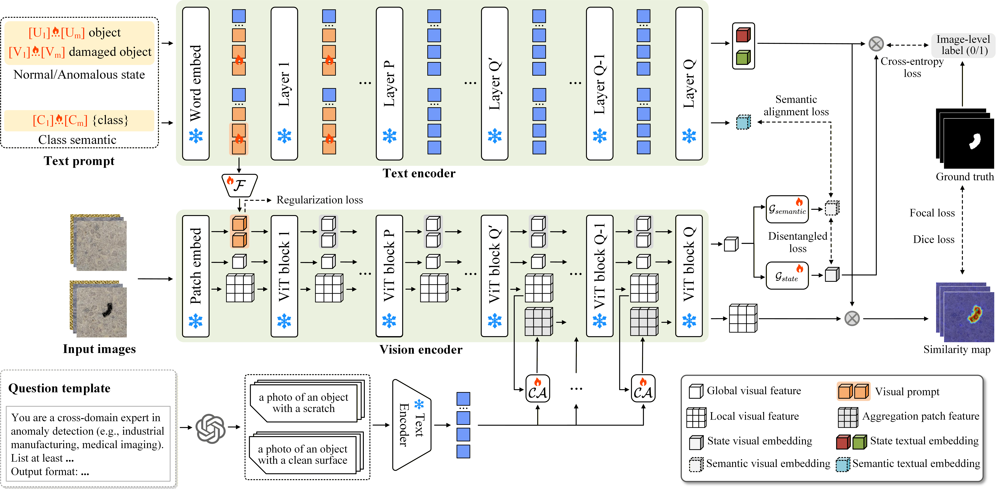

# DIVE

Official implementation of **"Robust Zero-shot Anomaly Detection under Limited Auxiliary Anomaly Priors"**, accepted by **ECCV 2026**.

[**Paper**](https://arxiv.org/abs/2606.29428) | [**Video**](https://www.youtube.com/watch?v=ZEDxc8S4H5A)

---

## Paper Abstract

Zero-shot anomaly detection aims to identify defects in arbitrary novel domains; however, existing models assume that the auxiliary data contains a rich diversity of anomalies, neglecting the far more complex and unpredictable variations in real-world target domains. This study introduces DIVE, the first approach to investigate the scenario of limited auxiliary anomaly priors and resolve the resulting substantial performance degradation. Through a shallow-and-deep text embedding injection strategy during visual encoding, DIVE learns to abstract generic anomaly concepts shared across the auxiliary training domain and diverse target domains. Moreover, we propose a disentanglement mechanism to tackle the suboptimal alignment between visual embeddings entangled with object semantics and object-agnostic textual prompts. Experiments demonstrate that, under the setting of limited anomaly patterns in auxiliary data, DIVE outperforms SOTA baselines by up to 16.2% and 28.5% on two classification metrics, and 23.4%, 24.1%, and 47.0% on three segmentation metrics, in terms of average performance across twelve datasets. Furthermore, it maintains highly competitive performance when auxiliary data exhibits sufficient anomaly diversity.

---

## Framework



---

## Experimental Results

We evaluate DIVE on **12 datasets** covering both industrial defect detection and medical image anomaly detection.

### Datasets

**Industrial anomaly detection**

- MVTec AD
- DTD
- Visa
- MPDD
- SDD
- BTAD

**Medical image anomaly detection**

- HeadCT
- Br35H
- BrainMRI
- ISIC
- ColonDB
- TN3K

### Results with DTD as Auxiliary Training Data

The following results correspond to **Table 1** in the paper. DTD contains relatively limited anomaly diversity and is used to evaluate model generalization under limited auxiliary anomaly priors.

**Best** results are shown in bold and <u>second-best</u> results are underlined.

#### Image-level Classification

Results are reported as **(AUROC, AP)**.

| Dataset | AnomalyCLIP | AdaCLIP | AF-CLIP | AA-CLIP | TPS | DIVE |
| --- | --- | --- | --- | --- | --- | --- |
| HeadCT | (95.1, 68.6) | (84.1, 47.7) | (70.9, 21.6) | (75.4, 28.1) | (<u>97.9</u>, <u>84.8</u>) | (**99.1**, **92.1**) |
| Br35H | (91.6, 55.8) | (92.2, 49.7) | (59.6, 18.4) | (80.5, 44.2) | (<u>94.8</u>, <u>70.8</u>) | (**97.3**, **78.9**) |
| BrainMRI | (89.9, 61.6) | (92.8, 64.6) | (81.8, 52.5) | (83.1, 51.1) | (<u>93.6</u>, <u>74.7</u>) | (**96.4**, **81.2**) |
| MVTec | (81.7, 55.1) | (84.8, 63.9) | (<u>88.2</u>, <u>70.0</u>) | (78.4, 56.1) | (85.5, 69.5) | (**89.3**, **73.9**) |
| Visa | (66.8, 34.5) | (71.2, 41.1) | (<u>76.3</u>, <u>46.8</u>) | (60.8, 27.5) | (75.0, 45.0) | (**77.8**, **50.0**) |
| MPDD | (58.0, 21.9) | (63.0, 21.2) | (<u>68.2</u>, 21.2) | (43.5, 15.3) | (65.6, <u>25.0</u>) | (**71.8**, **30.1**) |
| SDD | (<u>79.1</u>, 51.2) | (72.0, 40.2) | (75.2, 41.0) | (72.1, 31.0) | (78.8, <u>56.3</u>) | (**81.7**, **66.6**) |
| BTAD | (72.0, 64.7) | (80.4, 68.1) | (**86.2**, <u>79.3</u>) | (74.8, 73.0) | (61.6, 57.6) | (<u>85.2</u>, **81.3**) |
| **Average** | (79.3, 51.7) | (80.1, 49.6) | (75.8, 43.9) | (71.1, 40.8) | (<u>81.6</u>, <u>60.5</u>) | (**87.3**, **69.3**) |

#### Pixel-level Segmentation

Results are reported as **(AUROC, AUPRO, RCPRO)**.

| Dataset | AnomalyCLIP | AdaCLIP | AF-CLIP | AA-CLIP | TPS | DIVE |
| --- | --- | --- | --- | --- | --- | --- |
| ISIC | (70.7, 45.5, 41.2) | (<u>83.5</u>, 15.5, 66.5) | (74.1, 64.0, 64.1) | (80.2, <u>71.8</u>, **89.3**) | (70.2, 45.2, 61.8) | (**86.4**, **76.5**, <u>74.2</u>) |
| ColonDB | (62.9, 26.2, 15.5) | (76.3, 17.3, 30.1) | (72.7, 58.8, 44.4) | (<u>78.7</u>, <u>63.2</u>, **59.6**) | (57.8, 18.6, 26.2) | (**81.8**, **68.2**, <u>56.2</u>) |
| TN3K | (69.6, 21.5, 21.1) | (72.6, 8.1, 54.0) | (65.6, 44.9, 36.4) | (<u>79.0</u>, <u>52.7</u>, **68.6**) | (64.9, 26.2, 43.8) | (**81.3**, **55.8**, <u>56.8</u>) |
| MVTec | (80.9, 48.2, 23.1) | (89.4, 37.8, 24.3) | (<u>90.0</u>, <u>80.2</u>, <u>36.4</u>) | (89.6, 76.9, 21.9) | (66.0, 20.2, 0.3) | (**90.5**, **80.9**, **37.0**) |
| Visa | (82.1, 45.2, 3.6) | (90.6, 48.9, <u>14.1</u>) | (<u>91.2</u>, <u>73.9</u>, 10.9) | (90.0, 71.6, 8.7) | (68.8, 21.2, 0.2) | (**92.0**, **80.2**, **23.2**) |
| MPDD | (75.0, 22.0, 0.4) | (91.7, 57.5, <u>15.7</u>) | (<u>91.9</u>, <u>80.9</u>, 9.0) | (91.8, 78.2, 5.2) | (81.9, 42.4, 0.9) | (**93.7**, **81.7**, **24.3**) |
| SDD | (78.5, 38.3, <u>20.4</u>) | (84.5, 0.8, 4.2) | (86.2, 53.8, 8.3) | (<u>86.3</u>, <u>55.3</u>, 8.9) | (49.2, 9.5, 0.3) | (**86.9**, **65.0**, **24.4**) |
| BTAD | (63.3, 13.1, 5.4) | (84.4, 7.2, 15.9) | (**87.0**, **67.6**, <u>25.4</u>) | (79.9, 49.7, 11.9) | (52.3, 13.4, 4.3) | (<u>85.7</u>, <u>60.6</u>, **27.2**) |
| **Average** | (72.9, 32.5, 16.3) | (84.1, 24.1, 28.1) | (82.3, <u>65.5</u>, 29.4) | (<u>84.4</u>, 64.9, <u>34.3</u>) | (63.9, 24.6, 17.2) | (**87.3**, **71.1**, **40.4**) |

### Results with MVTec as Auxiliary Training Data

The following results correspond to **Table 2** in the paper. MVTec contains more diverse anomaly patterns and represents the setting with sufficient auxiliary anomaly diversity.

**Best** results are shown in bold and <u>second-best</u> results are underlined.

#### Image-level Classification

Results are reported as **(AUROC, AP)**.

| Dataset | AnomalyCLIP | AdaCLIP | AF-CLIP | AA-CLIP | TPS | DIVE |
| --- | --- | --- | --- | --- | --- | --- |
| HeadCT | (<u>98.3</u>, 77.9) | (97.4, 78.0) | (92.9, 69.9) | (87.5, 39.2) | (98.1, <u>82.4</u>) | (**99.1**, **91.2**) |
| Br35H | (95.1, 71.8) | (95.4, 72.6) | (<u>96.0</u>, <u>75.4</u>) | (82.5, 55.4) | (95.2, 73.4) | (**96.1**, **76.9**) |
| BrainMRI | (95.5, 77.2) | (91.2, 71.3) | (<u>96.5</u>, <u>79.0</u>) | (84.9, 52.7) | (94.1, 77.4) | (**97.3**, **84.0**) |
| DTD | (91.5, 78.3) | (**97.6**, **92.1**) | (89.6, 75.4) | (86.6, 77.2) | (91.3, 81.4) | (<u>92.8</u>, <u>84.0</u>) |
| Visa | (81.7, 53.7) | (83.4, 57.4) | (**85.0**, **61.8**) | (73.9, 43.5) | (83.3, 56.4) | (<u>84.0</u>, <u>57.7</u>) |
| MPDD | (72.2, 31.4) | (<u>75.1</u>, 38.8) | (74.0, <u>40.8</u>) | (59.7, 23.3) | (73.1, 31.9) | (**75.6**, **41.1**) |
| SDD | (83.0, 70.1) | (81.6, 59.5) | (73.7, 45.9) | (71.6, 40.7) | (<u>83.8</u>, **73.6**) | (**83.9**, <u>71.1</u>) |
| BTAD | (91.5, 87.1) | (90.9, <u>90.2</u>) | (<u>91.8</u>, 89.1) | (82.2, 85.4) | (90.7, 86.1) | (**92.0**, **90.4**) |
| **Average** | (88.6, 68.4) | (<u>89.1</u>, 70.0) | (87.4, 67.2) | (78.6, 52.2) | (88.7, <u>70.3</u>) | (**90.1**, **74.6**) |

#### Pixel-level Segmentation

Results are reported as **(AUROC, AUPRO, RCPRO)**.

| Dataset | AnomalyCLIP | AdaCLIP | AF-CLIP | AA-CLIP | TPS | DIVE |
| --- | --- | --- | --- | --- | --- | --- |
| ISIC | (84.9, 69.4, 69.6) | (81.4, 13.9, 69.4) | (**90.1**, **78.1**, **85.7**) | (77.6, 68.4, <u>85.4</u>) | (66.4, 40.0, 59.4) | (<u>88.5</u>, <u>76.4</u>, 73.9) |
| ColonDB | (<u>82.1</u>, <u>69.7</u>, 53.4) | (80.8, 21.2, 36.7) | (80.7, 66.6, 51.2) | (73.4, 63.0, <u>54.3</u>) | (60.1, 25.5, 28.1) | (**83.2**, **71.4**, **54.9**) |
| TN3K | (<u>82.0</u>, 49.3, 51.2) | (78.4, 5.8, 52.8) | (81.4, **62.2**, **62.7**) | (67.1, 35.5, 52.4) | (65.5, 28.9, 45.1) | (**84.1**, <u>54.5</u>, <u>55.7</u>) |
| DTD | (98.6, <u>92.8</u>, <u>48.1</u>) | (99.0, 65.9, 27.9) | (<u>99.5</u>, 92.0, 37.0) | (92.9, 81.5, 33.3) | (86.9, 65.5, 11.1) | (**99.7**, **94.7**, **49.9**) |
| Visa | (94.9, <u>81.8</u>, <u>24.5</u>) | (92.6, 33.9, 16.2) | (**96.2**, 81.1, 23.9) | (92.7, 76.8, 10.9) | (79.4, 44.7, 0.6) | (<u>95.0</u>, **85.1**, **25.4**) |
| MPDD | (92.3, 77.8, 17.8) | (94.5, 24.3, 17.7) | (<u>95.3</u>, 82.4, **20.4**) | (94.5, <u>82.5</u>, 7.6) | (87.5, 58.6, 0.2) | (**95.5**, **84.4**, <u>18.5</u>) |
| SDD | (**91.3**, <u>59.9</u>, <u>32.6</u>) | (86.0, 35.2, 26.8) | (<u>90.5</u>, 55.5, 26.0) | (77.0, 44.5, 9.9) | (72.6, 33.8, 6.2) | (88.2, **60.0**, **33.5**) |
| BTAD | (93.8, <u>72.9</u>, 34.0) | (93.6, 47.9, 29.4) | (**95.0**, 53.8, <u>34.6</u>) | (91.3, 71.7, 20.3) | (66.4, 29.9, 6.1) | (<u>94.3</u>, **73.6**, **37.6**) |
| **Average** | (<u>90.0</u>, <u>71.7</u>, 41.4) | (88.3, 31.0, 34.6) | (**91.1**, 71.5, <u>42.7</u>) | (83.3, 65.5, 34.3) | (73.1, 40.9, 19.6) | (**91.1**, **75.0**, **43.7**) |

---

## Implementation

The model is built upon **CLIP ViT-L/14@336px**.

Main experimental settings used in the paper:

- Input resolution: `518 × 518`
- Backbone: `CLIP ViT-L/14@336px`
- Optimizer: `Adam`
- Batch size: `8`
- Prompt learning rate: `1e-3`
- Cross-attention learning rate: `5e-5`
- Learnable prompt length: `m = 12`
- Prompting depth: `P = 9`
- Projected prompt length: `h = 4`
- Deep text injection: final four ViT blocks
- Framework: `PyTorch 2.0.0`

---

## Citation

If you find this work useful for your research, please consider citing our paper:

```bibtex
@inproceedings{lu2026dive,
  title={Robust Zero-shot Anomaly Detection under Limited Auxiliary Anomaly Priors},
  author={Lu, Guanyu and Zhou, Fang and Jin, Cheqing},
  booktitle={European Conference on Computer Vision},
  year={2026}
}
```